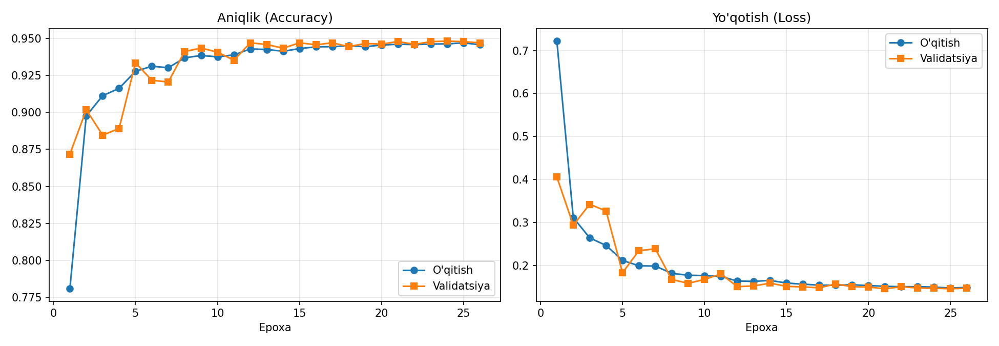
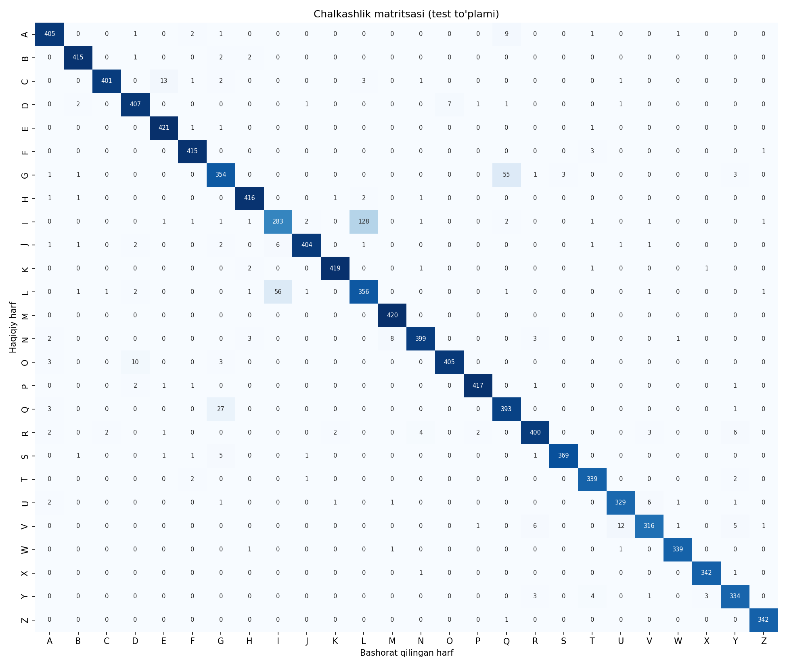
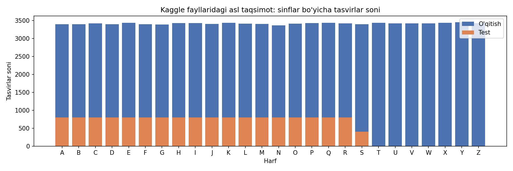

# Qo'lyozma harflarni aniqlash — EMNIST Letters (CNN)

Konvolyutsion neyron tarmog'i (CNN) yordamida 28×28 o'lchamli qo'lyozma harf tasvirlarini lotin alifbosining 26 ta harfidan (A–Z) biriga tasniflash.

**Mavzu:** Konvolyutsion neyron tarmoqlari (CNN) asosida tasvirlarni tasniflash modelini ishlab chiqish
**Ma'lumotlar:** [EMNIST (Extended MNIST), Kaggle](https://www.kaggle.com/datasets/crawford/emnist) — Letters qismi
**Vositalar:** Python, TensorFlow/Keras, NumPy, Pandas, Matplotlib, Seaborn, scikit-learn

## Natijalar (test to'plami, 10 360 ta tasvir, 26 sinf)

| Ko'rsatkich | Qiymat |
|---|---|
| Accuracy | **94.98%** |
| Precision (macro) | 95.18% |
| Recall (macro) | 95.11% |
| F1-score (macro) | 95.09% |





Eng ko'p xatolar shakli o'xshash harflar orasida: **I ↔ L** (katta «I» va kichik «l» qo'lyozmada deyarli bir xil) va **G ↔ Q** (kichik «g» va «q»). Qolgan harflarning barchasida F1-score 0.94 dan yuqori.

## Aniqlangan muammo: Kaggle test faylida T–Z harflari yo'q

Kaggle'dagi `emnist-letters-test.csv` fayli sinf bo'yicha tartiblangan va qirqilgan: unda A–R harflaridan 800 tadan, S dan 400 ta bor, **T–Z harflari umuman yo'q**.



Shu sababli ikkala fayl birlashtirildi, takrorlangan qatorlar olib tashlandi va ma'lumotlar stratifikatsiyalangan holda **80% o'qitish / 10% validatsiya / 10% test** nisbatda qayta bo'lindi.

| | Kaggle'ning asl bo'linishi | Qayta bo'lingan (yakuniy) |
|---|---|---|
| Testdagi harflar | 19 ta (A–S) | 26 ta (A–Z) |
| Accuracy | 93.56% | 94.98% |
| F1-score (macro) | 68.68% | 95.09% |

Dastlabki tajriba natijalari [`natijalar_eski/`](natijalar_eski) papkasida saqlangan.

## Model arxitekturasi

```
Kirish 28×28×1
 └─ Augmentatsiya (burish ±18°, siljitish 8%, masshtab 8%) — faqat o'qitishda
 └─ 2 × [Conv2D(32, 3×3) → BatchNorm → ReLU] → MaxPool → Dropout
 └─ 2 × [Conv2D(64, 3×3) → BatchNorm → ReLU] → MaxPool → Dropout
 └─ Conv2D(128, 3×3) → BatchNorm → ReLU → GlobalAveragePooling
 └─ Dense(256) → BatchNorm → ReLU → Dropout(0.3)
 └─ Dense(26, softmax)
```

180 282 ta parametr · Adam (lr = 0.001) · sparse categorical crossentropy · EarlyStopping + ReduceLROnPlateau · 26 epoxa (GPU'da 6.6 daqiqa)

### Giperparametrlarni sozlash

Har bir konfiguratsiya o'qitish to'plamining 25% qismida 4 epoxa o'qitildi:

| Learning rate | Dropout | Dense | Val. accuracy |
|---|---|---|---|
| **0.001** | **0.3** | **256** | **89.46%** |
| 0.003 | 0.3 | 256 | 89.09% |
| 0.001 | 0.5 | 256 | 88.99% |
| 0.001 | 0.3 | 128 | 87.23% |
| 0.0003 | 0.3 | 256 | 86.28% |

## Fayllar

| Fayl | Tavsifi |
|---|---|
| [`EMNIST_Letters_CNN.ipynb`](EMNIST_Letters_CNN.ipynb) | To'liq kod: yuklash, tahlil, ishlov berish, model, o'qitish, baholash |
| [`harf_chizish.py`](harf_chizish.py) | Sichqoncha bilan harf chizib, modelni sinash dasturi |
| [`natijalar/`](natijalar) | O'qitilgan model (`emnist_letters_cnn.keras`), grafiklar va metrikalar (CSV) |
| [`natijalar_eski/`](natijalar_eski) | Kaggle'ning asl bo'linishi bilan olingan dastlabki natijalar |
| [`requirements.txt`](requirements.txt) | Kerakli kutubxonalar |

## Ishga tushirish

**Google Colab:** notebookni yuklang → *Runtime → Change runtime type → T4 GPU* → *Run all*. Ma'lumotlar Kaggle'dan avtomatik yuklanadi (`kagglehub`), Kaggle hisobi talab qilinmaydi.

**Lokal:**

```bash
pip install -r requirements.txt
jupyter notebook EMNIST_Letters_CNN.ipynb
```

**Modelni sinash (harf chizish):**

```bash
python harf_chizish.py
```

## Adabiyotlar

1. Cohen G., Afshar S., Tapson J., van Schaik A. *EMNIST: an extension of MNIST to handwritten letters.* arXiv:1702.05373, 2017.
2. LeCun Y. et al. *Gradient-based learning applied to document recognition.* Proc. IEEE, 1998.
3. Ioffe S., Szegedy C. *Batch Normalization.* ICML, 2015.
4. Srivastava N. et al. *Dropout: A Simple Way to Prevent Neural Networks from Overfitting.* JMLR, 2014.
